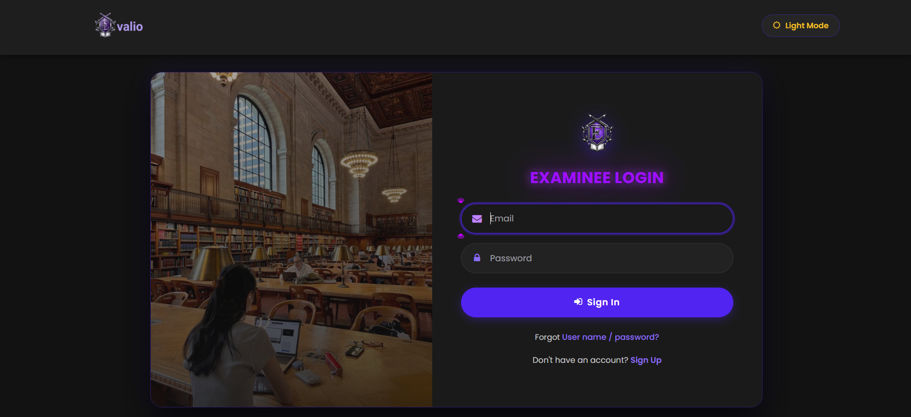
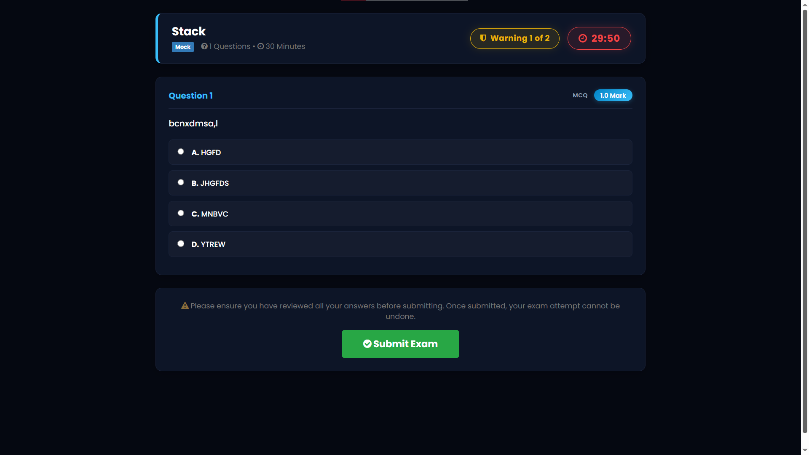
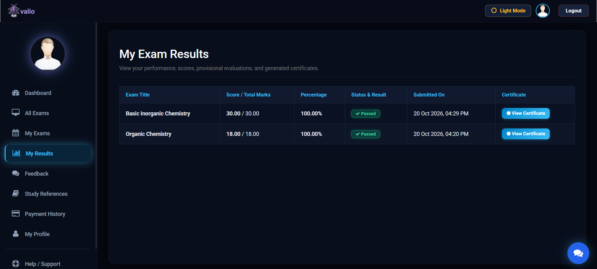
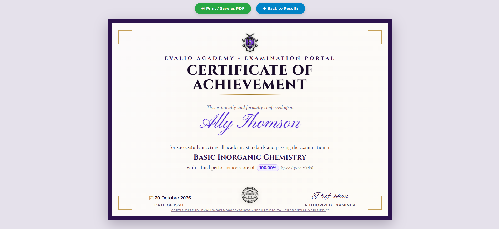
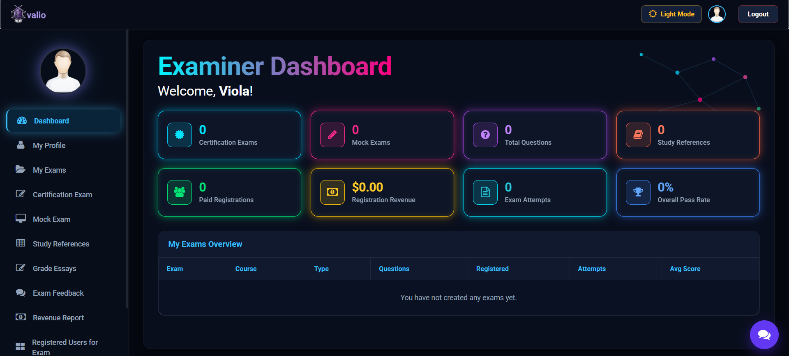
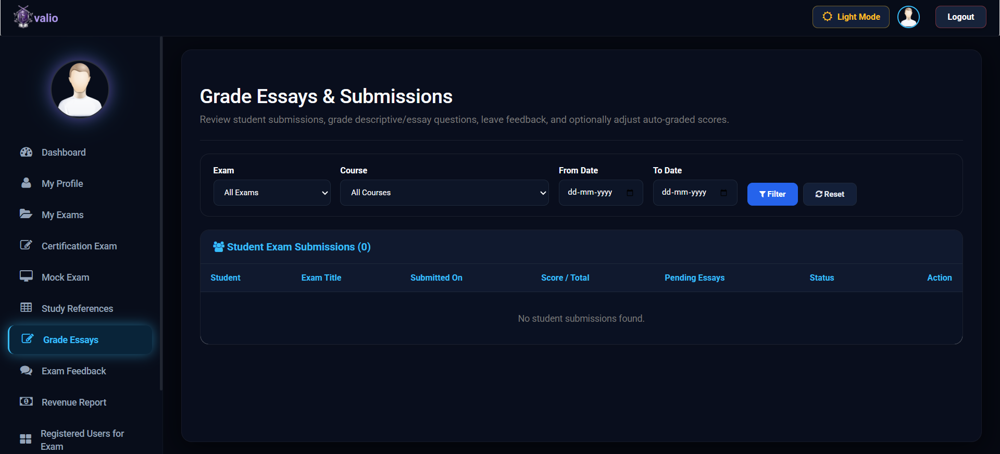
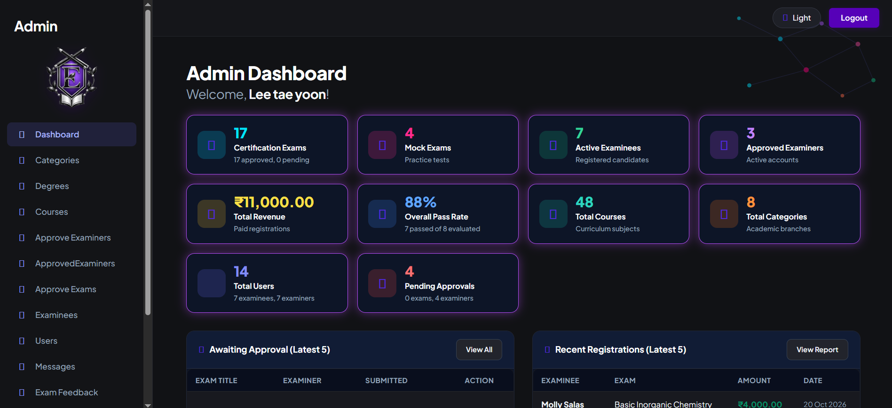

# EVALIO - Online Exam & Certification Platform

EVALIO is a web-based online examination, evaluation, and certification platform designed to facilitate secure assessments, automated and manual essay grading, student certifications, and performance reporting.

> **Note:** This is an academic project developed for educational purposes. All data in the included SQL file is dummy data.

---

## Screenshots

| Login | Exam list |
|-------|-----------|
|  |  |

| Exam screen | Results |
|-------------|---------|
|  |  |

| Certificate | Chatbot |
|-------------|---------|
|  |  |

| Examiner dashboard | Essay grading |
|--------------------|---------------|
|  |  |

| Admin dashboard |
|-----------------|
|  |

---

## Features by Role

### 1. Administrator (`admin/`)
- **Examiner Verification & Onboarding:** Review, approve, or reject examiner verification requests.
- **Exam Approvals:** Approve or reject certification exams submitted by examiners.
- **Master Data Management:** Manage academic categories, courses/subjects, and degrees.
- **Feedback Overview & Analytics:** Review exam ratings and student feedback with per-exam summaries and detailed review views.
- **User Management & Audit Trails:** Monitor examinee registrations, examinee exam records, and audit logs.
- **Revenue & Registration Reports:** View system-wide financial revenues and enrollment metrics.

### 2. Examiner (`examiner/`)
- **Exam Management:** Create, configure, and schedule Certification and Mock examinations.
- **Question Creation:** Author question banks supporting Multiple Choice (MCQ), True/False, Short Answer, Fill-in-the-Blanks, Matching Pairs, and Descriptive Essay questions.
- **Grading & Evaluation:** Review student exam attempts, grade descriptive essay responses with feedback, and optionally override auto-graded scores (`grade_essays.php`).
- **Submission Filtering:** Filter student exam submissions by Exam, Course, and Date range (`grade_essays.php`).
- **Reports & Earnings:** Track registered students and analyze earned revenue with exportable reports.

### 3. Examinee (`examinee/`)
- **Course & Exam Discovery:** Browse available mock and certification exams by course category.
- **Enrollment & Payments:** Online registration and exam fee payment workflows with payment history and receipts.
- **Distraction-Free Exam Screen:** Standalone examination interface with fullscreen enforcement, live countdown timers, and tab-switch violation warnings (`takeexam.php`).
- **Results & Performance:** Instant scoring for auto-graded questions and provisional/finalized result breakdowns.
- **Certificates:** View earned completion certificates.
- **Study References:** Access examiner-provided study references and materials.
- **Feedback & Ratings:** Submit and manage feedback ratings for completed exams.
- **Chatbot Assistant:** Built-in keyword-based chatbot (no external API or AI service) that answers common questions about exams, fees, results and certificates. Answers can be edited in `chatbot/kb/`.

---

## Technology Stack

- **Backend:** PHP (Native/OOP)
- **Database:** MySQL / MariaDB
- **Frontend:** HTML5, CSS3, JavaScript, Bootstrap, jQuery, Font Awesome
- **Local Server Environment:** WAMP / XAMPP on Apache
- **Architecture:** Role-based portals with shared core utilities and Data Access Object (`DataAccess`) pattern

---

## Folder Structure

```text
Projectmca25011/
├── admin/            # Administrator portal and management modules
├── assets/           # CSS stylesheets, JavaScript files, images, and vendor assets
├── chatbot/          # Keyword-based chatbot (api.php, engine.php, kb/ answers, widget)
├── classes/          # Core PHP helper and business logic classes
│   ├── DataAccess.class.php
│   ├── Grader.class.php
│   ├── FormValidator.class.php
│   └── FormAssist.class.php
├── config/           # Database and application autoload configuration
│   ├── database.php
│   └── autoload.php
├── docs/
│   └── screenshots/  # Screenshots used in this README
├── examinee/         # Student portal (exam taking, results, certificates, feedback)
├── examiner/         # Examiner portal (exam creation, essay grading, revenue)
├── uploads/          # Uploaded media (kept empty in Git, see setup note below)
├── .htaccess         # Apache settings (no directory listing, basic security headers)
├── .gitignore
└── onexam.sql        # Database schema and sample data
```

---

## Local Setup Instructions

1. **Install Local Server:**
   - Install and launch **WAMP Server** or **XAMPP** with Apache, PHP, and MySQL enabled.

2. **Copy Project Files:**
   - Place the `Projectmca25011` directory into your web server root:
     - **WAMP:** `C:\wamp64\www\Projectmca25011`
     - **XAMPP:** `C:\xampp\htdocs\Projectmca25011`

3. **Import Database:**
   - Open **phpMyAdmin** in your browser at `http://localhost/phpmyadmin/`.
   - Create a new database named `onexam` with collation `utf8mb4_unicode_ci` (or default).
   - Click **Import** and select the SQL file in the project root (`onexam.sql`).
   - Run the import until all tables and sample records are created.

4. **Verify Database Configuration:**
   - Open `config/database.php` and confirm the database details match your local setup (default WAMP/XAMPP values: host `localhost`, database `onexam`, user `root`, empty password).

5. **Check the uploads folders:**
   - Make sure `uploads/`, `uploads/certificates/`, `uploads/exams/` and `uploads/profile/` exist and are writable. They are included as empty folders.
   - Uploaded files (profile photos, exam images, examiner certificates) are not stored in this repository, so the sample records in the SQL file will show no images until you upload new ones.

6. **Launch Application:**
   - Open your web browser and navigate to:
     ```text
     http://localhost/Projectmca25011
     ```

---

## Default Login & Accounts Note

- **Examinee & Examiner:** Create accounts through their registration forms (`examinee/registration1.php` and `examiner/registration1.php`). Examiner accounts must be approved by an admin before they can log in.
- **Administrator:** A default admin account is included in the SQL seed data (`admins` table). Admins are created directly in the database, not through registration. Change the admin password after importing if you deploy this anywhere beyond localhost.

---

## Academic Project Notice

This project was developed as an academic (MCA) project for learning purposes. It is not intended for production use.
